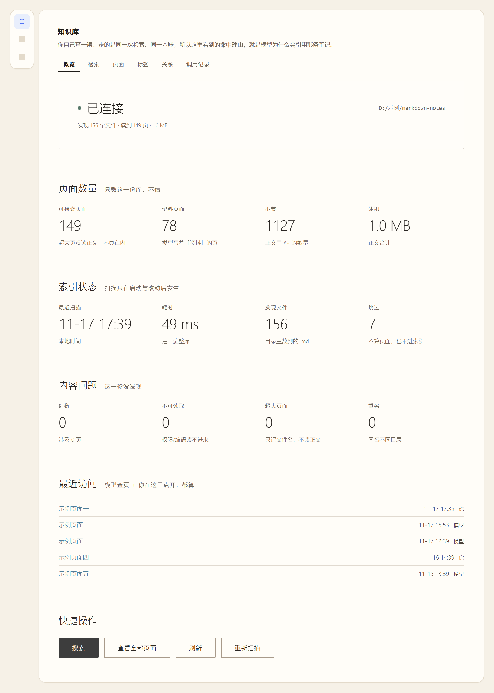

# dsh-wiki-notes

[](https://github.com/deepseek-ai)

**把一整个 Markdown 笔记库，变成模型能直接查的四个只读工具。**


它是干这个的：你有一堆笔记（Obsidian 库、导出的文档目录都行），模型要回答的问题，答案就写在里面。没这个插件，它得自己走五步 —— 读总览 → 读索引 → 敲命令搜 → 打开那页 → 追来源，还未必读对。装上之后它调一次 `wiki_recall`，拿回来的就是**命中小节的完整正文 + 出处**，接着就能答。

**三个入口，同一份数据：**

| 在哪 | 干什么 |
| --- | --- |
| 左侧栏最上面那本书 | 整页工作台：检索 / 概览 / 调用记录 |
| 设置 → 知识库 | 配库路径、看扫描状态 |
| 右侧栏「知识库」页签 | 边聊边查，不离开对话 |

只读、不联网、不外发笔记；零第三方依赖，装完就能用。为 [DeepSeek Harness](https://github.com/deepseek-ai) 而做。

> 中文文档从下面开始。实测：73 页的库，旧流程单次 ≈ 18.7k 字符，新流程 ≈ 2.5k。

---

## 目录

| 你想知道 | 直接跳 |
| --- | --- |
| 这插件到底能干什么 | [四个工具](#四个工具) |
| 左侧栏那本书点开是什么 | [知识库页（左侧栏）](#知识库页左侧栏) |
| 我要先装上试试 | [装](#装) · [配](#配) |
| 我自己的笔记该怎么写 | [库该长什么样](#库该长什么样) |
| 检索为什么这么打分 | [检索质量](#检索质量) |
| 它有没有偷看我的东西 | [只读，且不往外发](#只读且不往外发) |
| 旧版本有没有遗留 | [发布物与残余风险](#发布物与残余风险) |
| 已知毛病 | [已知局限](#已知局限) |
| 要改代码 | [目录 / 开发](#目录--开发) |

---

## 四个工具

插件注册四个工具，用途不重叠，按顺序读就明白了：

| 工具 | 一句话 | 什么时候用 |
| --- | --- | --- |
| **`wiki_recall`** | 检索库，拿到命中小节的正文与出处 | 「我的笔记里怎么写的？」 |
| **`wiki_context`** | 检索 + 抽证据 + 标缺口 + 给回答约束，**一次做完** | 要引用笔记原文回答，或想知道「依据够不够」 |
| **`wiki_verify`** | 拿已有的 context 核验一段回答，**不重新检索** | 答案写完了自查，特别是有数字的时候 |
| **`wiki_observe`** | 查观察日志统计（调用次数、支持状态分布、违规类型） | 诊断，不参与回答 |

设置页里只有一个「知识库」入口，进去分两个页签：**概览**（路径、体检、提示词）和**调用记录**（谁在什么时候查了什么、查到没有）。后者不是工具，是那本账的界面。

### `wiki_recall` —— 检索

一个工具，七种 mode：

| mode | 干什么 | 参数 |
| --- | --- | --- |
| `search`（默认） | 关键词 AND 检索；`type` / `tags` / `status` 过滤在主路径和覆盖率兜底里都生效 | `query`、`type`、`tags`、`status`、`limit`（5，≤12）、`sectionChars`（900，≤3000） |
| `page` | 按页名/别名取整页，或只取一节 | `name`、`section`（小节标题或 1-based 序号）、`pageChars`（6000） |
| `list` | 按类型/标签/状态列目录 | `type`、`tags`、`status`、`limit`（40，≤200） |
| `overview` | 总览 + 规模行 + 最近日志 + 健康计数 | `pageChars`（4000）、`logLimit`（5，≤20） |
| `lint` | 库健康检查：孤儿页、断链名字、缺字段、别名冲突、久未更新、无出链、草稿、index 与磁盘不一致；**并和上次体检对比，报出新增与已修** | `limit`（8，≤40）、`staleDays`（120） |
| `draft` | 把好答案回写成新页的落盘骨架（目录、frontmatter、index 行、log 条），不写文件 | `title`、`type`、`tags`、`summary`、`sources` |
| `help` | 用法与状态说明：七个 mode 各返回什么、`status` 各取值怎么读、参数默认值 | 无 |

```jsonc
{ "mode": "search", "query": "上下文 预算", "limit": 5 }
```

`status` 按 frontmatter「状态」筛，取值是五档：`草稿` / `演进中` / `稳定` / `存疑` / `已归档`（`已归档` 记生命周期，与成熟度不同维度）。`page` 的 `section` 只认有标题的小节；页首无标题前言不按序号计入，找不到时返回 `no_match` 并列出现有小节，不会把整页正文混进来。

每条命中带 `kind`（note / raw-summary / source）、`sources`（来源数，**证据强度的唯一可靠代理**）、`status`、`gist`、`section`（命中小节正文，不是 90 字片段）、`citation`（`← [[页名]] §小节 → 路径`）、`brokenLinks`（指向不存在页的双链 = 「库里没依据」的硬信号），以及 `updated` 后面的**距今天数**（超过 180 天标「可能已过时」——三年前的结论和上周的长得一样，模型需要这个信号）。`overview` 额外给三项健康信号：index 有磁盘无、磁盘有 index 无、跨目录重名。

零命中时不是一句「没有」就完了：返回里多一个 `nearMiss`（最多 3 页），每页带字面覆盖率、页名，以及 `filtered` —— `true` 表示**这次是你自己筛掉的**（类型/标签/状态），不是库里没有。渲染出来是一行「最接近的 3 页：xxx（字面沾边 42%，被这次的过滤条件筛掉）」，后面跟一句「这些只是字面最沾边，不等于它们回答了问题」。

有命中时 `nearMiss` 恒为空数组：它只做诊断，永不混进 `hits`，也不会让「命中 0 页」变成「命中 3 页」。

### `wiki_context` —— 带证据的上下文

要引用笔记原文回答、或需要知道「有没有依据 / 依据够不够 / 哪里是缺口」时用它，而不是自己连续调 `wiki_recall`。

参数：`query`（必填）、`limit`（1–12，默认 5）、`engine`（`both` / `search` / `wiki_recall`，默认 `both`）、`ttl_seconds`（默认 1800）。

返回里最重要的一条：**`status.support` 和 `status.degraded` 是两件事，必须分开看。**

- `support` 说的是**知识够不够**（`sufficient` / `partial` / `insufficient`）。
- `degraded` 说的是**引擎有没有坏**。它是布尔值，为真时说明某个检索通道挂了 —— 这时候不能把 `support` 当结论，那是拿不完整的检索结果下的判断。

同时返回 `evidence`（证据页，含分级、支撑了哪个槽位）、`missing`（缺什么、为什么缺）、`conflicts`（冲突候选，**未裁决，别当成已确认的结论**）、`answer.contract_text`（给回答的约束：必须披露缺口、不得超出证据、引文须原文），以及一个 `context_id`。模型看到的渲染文本里，每张证据页最多再附 2 条原文引文（每条按槽位标注、裁到 220 字）；JSON 结构不变，引文仍是页面原文子串，不是插件替你概括的。

`degraded` 为真时要先修通道，再谈结论。返回里的 `engines` 会写清每个通道的状态（`{"search":{"status":"ok"},"wiki_recall":{"status":"ok"}}`），`degraded_sources` 则点名是哪个死了。想直接体检这条通路，跑 `node tools/verify-bridge.mjs`：它真起一次 Python 管线，逐项断言「两个引擎都活着 / 没被标降级 / 带回了证据 / observe 认得回来」。

> 2026-11-17 踩过的一个真实故障：`wiki_recall` 通道长期是死的，于是每次 `wiki_context` 都挂 `degraded:true`，而 `support` 看上去还有值 —— 单看 `support` 会以为「库里的证据就这样」。根因不在 Python 也不在检索，而是插件调桥时**少传了一个环境变量** `WIKI_PLUGIN_DIR`：管线的 `wiki_recall` 引擎是回头调本插件的 `node bin/cli.mjs search`（见 `context_builder.py` 的 `run_plugin`），拿不到插件目录就把 cwd 落在工具目录，`bin/cli.mjs` 不存在，stdout 空，那边 `json.loads('')` 抛错，引擎判死。现在 `lib/index.js` 每次都传它，`tests/bridge.mjs` 里有一条源码守卫盯着这行 —— 假 python 的单元测试看不见这种故障，因为它压根不调真管线。

### `wiki_verify` —— 核验回答

写完答案后自查（尤其含数字、范围、年份、题量分值这类主张时）用它。参数：`context_id` + `answer`（可选 `observe_id`，一般不用传，插件会自动带上）。

它不重新检索 —— 拿当初那份快照来比，所以快，也不受库里后来改动的影响。

返回 `status` 与 `violations`：violations 非空说明回答越过了证据允许的边界，每条都带类型、主张和原因。另有 `notices` 单独放「说不清」的提示 —— **「说不清」不等于「说错了」**，模型若只读 violations 会漏掉这一块。

`context_expired` / `context_missing` 是**快照问题**，不等于回答错了：重新取一份 context 再核验就行。

每次核验都会往观察日志追加一条记录，并用 `parent_observe_id` 指回当初那份 context —— 这样「哪次核验修好了哪次回答」在日志里追得回。

### `wiki_observe` —— 诊断

参数：`days`（1–365，默认 7）、`limit`（1–50，默认 10）。

报观察窗口内的调用次数、支持状态分布、检索状态分布、违规类型分布，还有**修正情况**（核验过的 context 里已改正 / 仍未改正的比例）—— 这一项比违规总数更能反映核验到底有没有用。只读诊断，不参与回答，也不改检索行为。

> ⚠️ 它只看**网关**那三次调用（`wiki_context` / `wiki_verify`）。`wiki_recall` 不走 Python，也就不写观察日志 —— 要看全部调用，去「知识库」页的「调用记录」页签。

### 调用审计 —— 「知识库」页的「调用记录」页签

在设置页的「知识库」里切到第二个页签。模型和面板**每一次**查库都会记一行，回答的是「我这句问话，它到底查了没有、查到没有」。

三格数字（今日调用 / 命中率 / 零命中）+ 一张表，列是：**时间（日期 + 时刻，跨天那行日期加深）· 来源 · 工具 · 模式 · 问题 · 命中 · 耗时 · 诊断 · 成败**。筛选有「全部 / 模型 / 面板」与「只看零命中」，选中项有高亮与 `aria-pressed`。表按 10 条一页翻，不把 200 行堆成一堵墙。

表格下面还有一张「**反复打空的查询**」：同一句问话被查了 3 次还是 0 命中，说明不是运气差，要么库里真没有，要么说法对不上。这张卡按问法归并、按次数降序，最多列 5 条。

页面每 2 秒自己刷新；错误按 400 / 403 / 500 给出下一步并可重试。

账本落在插件目录旁的 `calls.jsonl`（已在 `.gitignore` 里），记 13 个字段：

```
ts · source · tool · mode · query · hits · ms · ok
status · fallback · considered · warnings · topScore
```

前 8 个是「发生了什么」，后 5 个是「为什么是这样」：`status` 是这次结果的状态（`ok` / `partial` / `no_match` / `unconfigured` / `error`），`fallback` 说明靠哪层兜底（`coverage` 字面兜底 / `or` 放宽 OR / 空 = 正常），`considered` 是参与比对的页数，`warnings` 是警告条数，`topScore` 是最高分。

**没有这 5 个字段的时候，「0 命中」是一句没法追责的话**：换词重搜、放开过滤、修库路径，三种下一步长得一模一样。现在「命中」格悬停会显示「参与 N 页 · 最高 X 分」，诊断列直接标出「字面兜底 / 放宽 OR」。

**页面路径、正文、答案一律不进账本。** `query` 截到 120 字。

几条口径值得写清楚：

- **命中率的分母不含 `wiki_verify` / `wiki_observe`**，也不算 `page` / `list` 这类非检索模式 —— 它们没有「命中几页」这回事，记成 0 会把命中率系统性压低，所以记 `null`，不进统计。
- **它只能看见「发生了的调用」**。模型压根没想起来查库，这里也不会有记录 —— 那是一种缺席，账本记不了缺席。要统计「哪类问题从来不查库」，得去读会话转录（本插件不读）。
- 记满 5000 行轮转一次，只留最近 2500 行；读取只扫文件尾部 256 KB。
- 记账是**旁路**：写不进去只打一行警告，工具的返回值一个字都不改。`calls.enabled` 可以整个关掉。

---

## 设计从哪来

库结构来自 [Karpathy 的 `llm-wiki.md`](https://gist.github.com/karpathy/442a6bf555914893e9891c11519de94f)：与其每次提问都从原始文档重新检索（知识不累积），不如让 LLM 增量维护一个持久的 wiki。本插件只加速其中的 **Query** 一段。

| gist 里的概念 | 本插件默认位置 |
| --- | --- |
| Raw sources（不可变） | `原始资料-raw/` |
| The wiki（LLM 维护） | `知识层-wiki/` |
| The schema | 库根 `AGENTS.md` |
| `index.md` + `log.md` | 同名同格式 |

---

## 库该长什么样

**一个目录 + 一堆 `.md` 就能用。** 更细的约定见 [docs/库结构.md](docs/库结构.md)：frontmatter 七字段（英文写法 `title/type/tags/aliases/status/created/updated/sources` 也认）、`index.md` 摘要目录、`log.md` 时间线、`总览-overview.md`，满足得越多检索越准。可跑的样例在 [`examples/sample-wiki/`](examples/sample-wiki/)。

路径指到上一层（比如 `LLM-Wiki/`，里面还有 `原始资料-raw/` 和 `知识层-wiki/`）也没关系：插件会认 `index.md`，自动下钻到知识层，并在返回里注明它实际读的是哪一层。

---

## 装

在 DSH 里说一句即可：**「帮我装一个 DSH 插件，目录是 `<绝对路径>`」**。或自己发：

```
plugin_manager { action: "install_bundle", target: "<绝对路径>" }
```

返回 `application: applied` 就生效，不用重启。但**改插件自己的代码要重启 DSH**：`lib/*.js`（宿主半）和 `lib/client.js`（设置页）都一样，已载入的模块不会因为关开插件而重新求值。

想先看它到底怎么读库、不打算马上接自己的笔记：仓库里带了一个**跟笔记完全无关的小库** `examples/demo-wiki/`（10 页手冲咖啡笔记，含标签、别名、双链、一条红链、一个孤岛页），直接跑：

```bash
node bin/cli.mjs search 萃取率怎么调 --root examples/demo-wiki
WIKI_ROOT="<仓库绝对路径>/examples/demo-wiki" node tools/verify-host.mjs --self
```

它存在的意思是：这套东西只认「目录 + `.md` + frontmatter」，不认领域 —— 换一个库不需要改一行代码。

---

## 配

**设置 →「知识库」**，填路径 → 测试 → 保存。四层优先级：

| 优先级 | 来源 |
| --- | --- |
| 1 | 插件 config 的 `root` |
| 2 | 环境变量 `DSH_WIKI_ROOT` |
| 3 | `wiki-notes.config.json`（设置页写这里） |
| 4 | `lib/config.js` 的 `DEFAULT_WIKI_ROOT`（默认空） |

设置页改的路径写入第 3 层；若第 1 层 `config.root` 或第 2 层 `DSH_WIKI_ROOT` 正在覆盖，界面会明确提示「保存也盖不过它」，保存后也不会谎称「已保存并生效」。优先级本身保持不变。

没配时工具会直接告诉你「还没配置知识库路径」，不会静默扫空目录。

`wiki_context` / `wiki_verify` / `wiki_observe` 还需要一条 Python 通路（`bridge.python` + `bridge.toolsRoot`，后者是含 `wiki_bridge.py` 的目录）。没配或配错时这三个工具会明确报错，且**不会假装成「知识库里没有」**：

| 情况 | 错误码 |
|---|---|
| 还没配 `bridge.toolsRoot` | `E_TOOLS_ROOT_MISSING` |
| 配了但目录不存在 | `E_TOOLS_ROOT_MISSING` |
| 目录在、里面没有 `wiki_bridge.py` | `E_BRIDGE_SCRIPT_MISSING` |
| `bridge.python` 找不到（不在 PATH、路径写错） | `E_PYTHON_UNAVAILABLE` |

配置形状见 [docs/契约-stage0/阶段4-插件接入.md](docs/契约-stage0/阶段4-插件接入.md)。

---

## 模型怎么知道该查库

插件会从你库里现有的 `标签` 算出主题词，注入一行（约 50 token，例如「本地知识库主题：上下文工程、ai、agent…」）。不带页数 —— 页数一变就会打掉提示词的前缀缓存，而它对「该不该查」没有帮助。换库自动变，所以问题沾这些主题时它自己会去查，不用你提醒。设置页里可以关掉（不占上下文）、换成自己的整段、或在末尾追加一句，改完下一回合生效。

主题词怎么挑：跳过 `总览`/`index` 这类结构页，跳过 `数据`/`工具`/`meta` 这类空泛标签，默认只留出现 ≥2 次的标签（设置页可改回 ≥1）。全被滤掉时退回不过滤的前五 —— 小库不至于一条提示都没有。

---

## 设置页

设置 →「知识库」。状态栏圆点表示实时同步是否生效，三个数字是页面 / 资料页 / 红链页，下面是路径卡片和 `测试 · 保存并生效 · 重新扫描`。一次没配过时，卡片会变成三步引导。被 profile 的 `config.root` 或环境变量覆盖时，路径卡片会直接说明「保存改不动生效路径」；保存成功提示也会区分「已生效」与「已保存但仍被覆盖」。

浏览器半侧走同源 HTTP `/api/wiki-notes/*`（`state` / `search` / `check` / `save` / `rescan`），不碰 RPC。

标题右边那颗「**打开知识库页**」就是跳到下面这一页 —— 配置和看库分在两处，跳一次比来回切设置省事。

---

## 知识库页（左侧栏）

左侧栏最上面那本书，点进去是一整页工作台（不是弹层、不是设置里的一个 tab）。它是 DSH 的**主面板**之一，和「插件」「自动化任务」平级 —— 占满主列，切走会卸载，所以来回切不攒后台轮询。**概览是首页**，落地先看「这个库现在什么状况」，再决定去查什么：

| 页签 | 里面有什么 |
| --- | --- |
| 概览 | 状态 / 页面数量 / 索引 / 内容问题 / 使用情况 / 快捷操作，见下 |
| 检索 | 和右侧栏那个面板同一份组件（`compact:false`，宽屏下正文不再截高），能自己搜、看命中理由、复制出处 |
| 探索 · 标签 | 最常出现的 12 个标签（点一下带着词跳检索）+ 标签共现 + 有/没标签的页数 |
| 探索 · 关系 | 枢纽页、孤岛页、最该先补的页，加上任意一页的出链 / 入链 / 双向链 |
| 调用记录 | 就是上面那份账本，含「反复打空的查询」 |

一级页签只留四个动词：看状态（概览）、查内容（检索）、看结构（探索）、看模型怎么用（调用记录）。标签和关系都是「看结构」，合成一个窗、用一排子页签切换 —— 一级导航撑长了，多出来的不是信息。



概览按「先看库有没有毛病，再决定查什么」排，只摆这六块：

| 块 | 内容 | 为什么在这一块 |
| --- | --- | --- |
| 知识库状态 | 已连接 / 未配置 / 不可用，扫的是哪个目录，发现 N 个文件读到 M 页 | 先分清「搜不到」和「压根没配上」 |
| 页面数量 | 可检索页面、资料页面、小节数、体积 | 「可检索」是读进正文的页，超大未读的不算在内 |
| 索引状态 | 最近一次扫描的时刻、耗时、发现与跳过的文件数 | 见过改了笔记却查不到的，多半是没重扫 |
| 内容问题 | 红链几处、涉及几页，不可读取、超大页面、重名 | 断链是库里的洞，不修就永远查不到 |
| 使用情况 | 模型调了几次、你自己在面板里查了几次、零命中率、今天几条 | 与「调用记录」页签同一本账，两个数不可能对不上 |
| 快捷操作 | 搜索、调用记录、查看异常、刷新、重新扫描 | 这一页的动词就够，其余回设置页 |

标签、关系同住「探索」窗（里面一排子页签切换），不挤在首页 —— 五块计数还没看完，榜单已经滑出视野了。**一个组件出三个窗**（`view` 区分，探索窗里再分子页），不是三个组件各读一遍 `/state`；同一个数在两处出现，迟早会算出两个答案。

标签是入口不是装饰：点一个标签，检索页签打开、查询框里就是那个词、结果已经查好。同一个词连点两次也会重跑（递下去的是序号，不是词本身）—— 只比文本比不出「又点了一次」。

**标签共现**（探索 · 标签的第二块）：每个高频标签旁边列三个「跟它一起出现最多」的标签，数字是共同出现的页数，点一下就是「两个词一起查」。检索只认字面命中，答不了「我还写过什么和它同时出现过」—— 这一栏补的就是这个问题。同一页里重复写同一个标签只算一次；页面数分母不带超大未读页，所以「没标签 N 页」是真的没打标签，不是没读。

**页面关联**（探索 · 关系的第二块）：写一个页名回车，得到这一页的**出链 / 入链 / 双向 / 红链**。点任一页名 = 看那一页的链接（顺着走），点「打开」= 交给系统默认程序。入链没有反向索引，只能逐页比一遍 —— 所以这一个数字是**现算**的，不像概览那些跟着扫描一起出。三条路由（概览入链、页面关联、红链归因）共用同一组解析函数（整名命中 → 别名小写 → 跳过 `index`/`log`、跳过自链），口径只留一份：分开写过一次，症状是「入链 0，红链也 0」，两边各自都像是对的。

**找不到这一页就 404。** 回一个空的四列会被人读成「这页没有链接」，而真相是「这页不在库里」—— 这两种情况的下一步动作完全不同。

**「使用情况」读的是调用账本那一本，不是另建一套统计。** 模型自己调的（`source:"model"`）和你手在面板里查的（`source:"panel"`）分开记两栏 —— 混在一起，「模型用了多少次知识库」就成了没法核对的数。零命中率的分母只算「有命中几页这回事」的调用，一次都没查过时显示「—」而不是 0%：没查过和查了没命中是两句话。四类工具没调过就摆 0 —— `wiki_observe` 是 0 意味着「没观察」，不是「观察了没问题」。

**这些数字全部由宿主算好再送过来，前端一个 `reduce` 都没有。** `GET /state` 里的 `overview` 与 `stats` 同源同一次扫描（`overviewOf(corpus)`），所以概览和状态卡不可能对不上；「可检索页面 = 全部 − 超大未读」这类减法也写在宿主，而不是在渲染时现算 —— 两个地方各算一遍，迟早会算出两个答案。

**这一页不替你读笔记。** 1.8.2 之前概览里有「最近访问」、页签里有「页面清单」，点一行把正文拉进面板里那段只读 `<pre>`；现在都撤了 —— 读笔记、改笔记、看反链，你自己的 markdown 编辑器（Obsidian 之类）本来就做得更好，面板再抄一份只是把同一件事做第二遍。关系窗里点一行（枢纽页 / 孤岛），仍然走 `POST /open` 交给系统默认程序（Windows 是 `cmd /c start`，macOS `open`，Linux `xdg-open`）—— 那里点的是「去那一页看看」，不是「在这里读一遍」。

`/open` 只认落在库根之内的路径（相对路径按库根解析），文件不在了回 404 带一句话 —— 这条路由要是能开任意路径，它就成了「本机任意文件 + 系统关联程序」的执行口，而它只是个看笔记的按钮。

概览只显示、不改：改路径和提示词仍然回设置页 —— 这里出现两颗「保存」按钮的话，人就会在错的地方改配置。

排版照 `design (1).md` 那套北欧极简：Inter、字重只用 200/300/400、卡片 2px 直角 + 无阴影 + hover 只改边框、过渡 700ms。样式全部限定在 `.wn-page` 作用域内的 `.hx-*` 前缀 —— 插件的 CSS 是往 `document.head` 里塞一个 `<style>`，不带作用域会漏进 DSH 自己的界面。

**对比度是照着设计稿又改了一遍的地方。** 设计稿的次级文字是 `#a89279`、卡片是 60% 白 —— 那套配色放在落地页上很轻，放进 DSH 的暖白画布就糊成一片，数字看着像禁用态。现在正文压到 `#2b2724`、次级文字 `#6f6558`、卡片实底 `#fffdf9` + 更实的描边，2px 直角与 700ms 过渡照旧（`tests/client.mjs` 把这几个值钉住了，免得哪天又被「调淡一点」改回去）。

图标是一本书（`icon.svg` 同一份线稿，颜色吃 `currentColor`，选中时线粗一点），不额外装图标库。

---

## 检索面板

同一个检索面板出现在三处：设置页的「试一试检索」卡、右侧栏的「知识库」页签、左侧栏知识库页的「检索」页签 —— 同一份组件，`compact` 控制密度。用途只有一个：**让人自己看见检索依据**，不必等模型说它查到了什么。

输入关键词回车，上面一行是「命中 7 页（显示前 5）· 参与打分 95 页 · 36 ms · 库 95 页」；紧跟一行是**查询诊断**：`实际用的词` 后面逐个列出这次真正参与打分的词，一页都没沾到的词会标成「没沾到」，末尾写清这次是「全词都要（AND）」还是「命中任一（OR）」。中文不分词，写整句时这一行通常只剩一个词 —— 这是最直观的提示：换词，而不是加词。

每条命中占一行，左边是名次、页名、类型，右边是一条按「相对第一名」缩放的分数条和总分。多类型命中会按类型分组（`概念（3）`、`资料（2）`…）。展开后有：

- 页名、类型、总分，以及「只命中部分词」的标记（该条没命中全部查询词）；
- **命中理由**：每个查询词一条徽章，主词加粗、明细灰字，例如 `上下文 · 页名 120 · 别名 50 · 正文 ×7 21`，未得分的词显示为「未命中」。悬停徽章有各通道的权重说明；
- 该条命中的小节标题与正文（正文里出现过的查询词带淡黄底纹），末尾附 citation，右侧一个复制按钮 —— 把「哪句话支撑了这条」直接抄进对话里；
- 查询降级成「命中任一」或「字面覆盖率兜底」时，计数行旁边会按实际路径分别黄字提示。

零命中时，列表位置会摆出**最接近的 3 页**：字面沾边多少百分比、有没有被这次的 `type`/`tags`/`status` 过滤筛掉，点一条就按它的措辞再搜一遍。这一栏只在零命中时出现，永不混进命中列表 —— 它回答的是「是库里没这块，还是我筛掉了它」，而不是假装自己命中了。

**最近查过**：查成功之后，输入框下面留一排词（最多 8 个，同一句不重复堆），点一下重查。它只活在这次会话里、不落盘 —— 这是「刚查过的还热着」，不是第三本账；写盘就得连带处理清理、隐私和跨设备不一致。

**键盘**：输入框防抖 350ms（够 2 个字符才查），`Enter` 立刻查，`Esc` 清空，`↑`/`↓` 在结果里移动高亮并展开对应条目；任意位置按 `/` 或 `Ctrl/⌘ + K` 直接跳到输入框。查询进行中列表上方显示「检索中…」。输入框右边有「复制词」—— 查出来的说法常常要拿去别处再查一遍，省得重敲；citation 那行的复制按钮同理（键盘走过去会看到焦点框）。

**覆盖统计**在设置页的状态卡下面：`发现 102 个文件 → 读到 95 页 / 677 个小节`，后面是总体积、跳过 / 读不了 / 超大未读 / 目录与 stat 失败的计数（非 0 时标黄）、最新修改时间、本次扫描耗时，以及这次实际扫的目录（自动下钻过时它和配置里的路径不是同一个）。

没查之前不是一片空白：显示库的规模、同步开关，以及库里出现最多的几个标签 —— 点一下直接拿它当查询词，省得先想「该查什么」。查不到时也顺带报覆盖：`参与检索 95 页 / 677 个小节 · 跳过 7` ——「没命中」和「那几页根本没读」是两回事，面板得能分清。`discovered = pages + unreadable + skipped` 在 `tests/api.mjs` 里当恒等式断言，这几个数不是凑出来的。

面板是只读的：不写库、不改配置、不进模型上下文。

**`explain` 是对既有检索的解释，不是第二套检索。** 引擎里分数只有一个实现 —— `termScore(page, token)` 就是 `termBreakdown(page, token).score`，理由和排序分数出自同一份明细，所以面板不可能显示「一套理由、另一套排序」；`tests/explain.mjs` 对同一批查询比对开关前后的 `name|score|allTerms` 逐条相同，还核对了「每个词的明细加起来 === 该条总分」。`explain` 也不在工具 schema 里：模型触发不到它，`wiki_recall` 的输出体积一个 token 都不变。

工具输出里新增两个短字段，是给**模型**看的而不是给面板看的：`matchMode`（`and`/`or`）和 `missedTerms`（一个词都没沾到的那些）—— 模型看到「这个词没用上」才可能换词重查。它们会被渲染成一行：`没沾到：量子纠缠（这些词在库里一页都没命中，换同义词或干脆去掉）`；没有漏词时这行不出现，正常路径不多花一个 token。而「每个词命中多少页」(`termPages`) 只在 `explain` 时出现：那是面板的事，模型用不上。

> 这条踩过一次：字段先加进了 `run()` 的返回值，但模型拿到的是 `renderValue()` 渲染出的文本 —— 不写进渲染，模型就等于没拿到。`tests/status.mjs` 现在有两条断言看着它（有漏词要出现、没漏词不许出现）。

侧栏是可选能力：`ctx.inject(['sidebarRightTabs'], …)` 运行时按需取，服务不在就静默跳过，设置页照常可用；`dsh.client.inject` 刻意不钉侧栏模块（钉了会把「侧栏在不在」变成整个客户端包的加载前提）。`tests/contract.mjs` 守着这两条。左侧栏那本书同理：`sidebar.panellist` + `main` 两个注入都是运行时按需取，`layout` 服务缺了只是「打开知识库页」这颗按钮不出现。

接口：`GET /api/wiki-notes/search?q=上下文 预算&limit=5`，`q` 截到 200 字，`limit` 夹在 1–12，缺 `q` 返回 400。

---

## 实时同步

`fs.watch(root, { recursive: true })`，`.md` 新增 / 改 / 删 → 400ms 防抖 → 作废缓存。监听失败自动退回 30 秒 TTL 缓存。`recursive` 在 Linux 需 Node 20.13+，这也是 `engines` 的下限。

---

## 检索质量

三条线分开看，别混成一个数字：

- **对齐（parity）**：`tests/local/ab.mjs` 比的是「JS 引擎的前 5 是否覆盖 Python `search.py` 的前 5」；`tests/local/metrics.mjs` 比同一批槽位的集合与排序（Recall@5 / Top-1 一致率 / Jaccard），当硬门禁。两侧刻意保留少量已知分歧（疑问词剥离是有意改进、index 摘要 +8、类型层平局裁决），名单在本地 `tests/local/parity-exceptions.json`，**不入仓库**。
- **质量（recall）**：`tests/local/recall.mjs` 跑人工标注的评测集，报 Recall@5 / Top-1 / MRR@5 并按标签分组。`queries.json` 里的 `floor` 与 `libraryFingerprint` 绑定：库内容变了要按规矩重导基线、把证据写进 `floorNote`，低于 floor 即 exit 2。评测集 `tests/local/queries.json` 含本机笔记主题，**不入仓库**；仓库里只有中性 6 条的 `queries.example.json`。
- **性能**：基准数字随库规模与机器变化，用 `tools/probe.mjs` 在本机攒 hit@1 / hit@3 / Recall@5 的趋势 CSV；别把某一次读数写进文档当承诺。

评分刻意朴素：标题全等 120 / 标题含 60 / 别名含 50 / 标签含 25 / 正文词频 ×3（封顶 36）/ index 摘要只在其它通道全 0 时补 8；同分再比类型层（综合 3 · 总览 3 / 概念·实体·对比 2 / 资料 1）→ 更新时间 → 码点序。四处经验细节：摘要分只补漏不抢位、同分用码点序（拼音序不可复现）、选节排除清单类与元讨论类小节、总览与综合同层（总览是全库唯一入口页，跨模块的词在它里面出现分量不同）。

中文连写整句在 AND / OR 双双落空时会降级到**字面覆盖率兜底**（中文二字组 / 拉丁整词，覆盖率 ≥45% 才入选，`degraded: true` 并在结果里说明），这是缓解不是语义检索；查询先做 NFKC 归一化并剥掉两端疑问词。

---

## 只读，且不往外发

- 插件只读你的笔记：不写库、不改页、不修红链。
- 检索在本地进程内跑，没有任何出站请求。
- `wiki_context` / `wiki_verify` 调的是**你自己机器上的** Python 管线（`bridge.toolsRoot`），同样不出网。
- 仓库里不含任何本机绝对路径或用户名；测试用环境变量拿真实路径（`WIKI_ROOT` / `WIKI_TOOLS`），不给就跑样例库。
- 公开仓库里的样例、契约文档与测试查询词一律用虚构语料，不写任何人的笔记主题。旧发布物仍有遗留，见下一节。

---

## 发布物与残余风险

**1.4.3 起是干净版本。** 仓库内 `docs/`（整目录进 `files`）、`examples/`、`tests/` 里的演示样例已全部换成虚构的「星港缓存」技术语料：没有真实引文、真实页面路径、外链、本机用户名、私有路径或凭据。发版前会解包 `npm pack` 的产物逐文件扫一遍，命中即视为发布失败。`wiki-notes.config.json` 是本机文件，`.gitignore` 覆盖，从未提交。

**1.4.2 及更早的公开传播源已经发出去了，收不回来：**

| 来源 | 情况 | 处置 |
| --- | --- | --- |
| npm `1.4.0` / `1.4.1` / `1.4.2` | 包内 `docs/契约-stage0/samples/` 与几份阶段文档含少量早期演示用的笔记引文、页面标题和一个外部链接；**不含**凭据、用户名、本机路径，也不是运行时采集的数据 | npm 不允许覆盖已发布版本 ⇒ 只把这三个版本标记 `deprecated`，提示升级到 `>=1.4.3`（更早的干净版本不误伤） |
| GitHub Release `v1.4.0` / `v1.4.1` / `v1.4.2` 的 tarball | 与对应 npm 包同源 | 不删 Release 记录，只删带内容的 tarball 资产；取包用 `v1.4.3` 或 `releases/latest/download/dsh-wiki-notes.tgz` |
| Git 历史 `36cfe85` 与标签 `v1.4.0`–`v1.4.2` 自动生成的源码归档 | `36cfe85` 曾写进本机绝对路径与用户名，`f82b125` 已在首个 1.4.0 npm 包发布**之前**清掉；但历史对象与标签归档仍在 | 不重写历史：改 tag SHA 会断掉已发 npm 包与 Release 的提交关联。在意的话请自行 fork 后清理 |

一句话结论：**升级到 `1.4.3+` 即可**；旧版本里那部分内容不会自行消失，别把旧包当「干净语料」再分发。这里只做事实登记，不假装把它们删干净了。

---

## 上下游（可选）

- **进料**：[Obsidian Web Clipper](https://github.com/obsidianmd/obsidian-clipper) —— 网页剪藏成 Markdown 落进 raw 层。模板里写好 `类型` / `来源数量` / `标签`，本插件的 `kind`、`sources`、证据强度才有东西可用。
- **维护**：[kepano/obsidian-skills](https://github.com/kepano/obsidian-skills) —— 六个 `SKILL.md`，教 agent 写 Obsidian 语法（wikilink / `.base` / `.canvas` / CLI），少猜少往返。

---

## 已知局限

- 中文不分词，靠空格切分；连写词靠 `别名` 补。整句中文拿不到命中时会降级成字面覆盖率排序，那是**字面**匹配，语义相近但用词不同照样认不出。
- 页名本身是查询词时，正文很少重复该词，选节可能偏。
- 每次调用全量扫描；具体耗时随库规模与机器变化，再大一个数量级要上增量索引。
- 每命中一页要塞约 900 字符正文（`sectionChars` 可调），一次返回 5 页就是 4–5k 字符 —— 瓶颈常在上下文预算而不在检索速度。
- `page` 的 `section` 只认有标题的小节：页首无标题前言按标题或序号都取不到，遇到它只能调大 `sectionChars`；`list` / `search` 也还没有 `dir` / `offset` 分页，超过 `limit` 上限的后半段要先按 `type` / `tags` / `status` 收窄。
- **重启后第一次扫描是冷盘读**：具体耗时随库规模与磁盘变化，插件启动就预热一次，所以这段延迟通常落在你还没提问的时候；但第一条查询正好赶上也确实要等。
- **面板没打开时 `/`、`Ctrl/⌘ + K` 不会有反应**：快捷键绑在面板上，而宿主的 `sidebarRightTabs` 只提供 `register()`，没有「打开 / 激活页签」的接口，插件没法从外面把面板叫出来。
- **知识网关那套仍是两套实现**：JS 侧 `wiki_recall` 和 Python 侧 `wiki_context` 各自解析页面，差在结构解读层。统一方向未定。
- **`unverifiable` 只在 `notices` 里**：模型若只看 `violations`，会漏掉「这个数字我核实不了」。
- **观察日志无轮转**：只追加不清理，`legacy` 计数会随时间变大。
- **快照不自动清理**，也没有滑动续期。

---

## 目录 / 开发

```
lib/corpus.js   扫描 + frontmatter / 小节 / 双链解析
lib/engine.js   评分、选节、七种模式（纯函数）
lib/config.js   库路径解析与配置读写
lib/index.js    插件入口：工具、渲染、设置页 API、目录监听
lib/client.js   设置页 + 检索面板 + 右侧栏页签（手写 bundle，无构建）
bin/cli.mjs     命令行，不装插件也能跑
tools/probe.mjs 检索质量探针：hit@1 / hit@3 / Recall@5，追加趋势 CSV
tools/preview.mjs 把面板渲染成静态页（真组件 + 真 CSS），改样式不必重启 DSH
tools/verify-host.mjs 宿主实机验收：--self 自己起个真 HTTP 服务打 10 项探针，--port 探已在跑的 DSH
tools/verify-bridge.mjs 真管线体检：起一次 Python 桥，断言两个引擎都活着、没被标降级
docs/库结构.md  库结构约定（这份才是一手文档）
docs/README.md  文档导航页
CHANGELOG.md    版本变更记录
docs/superpowers/specs/  检索面板的设计稿
docs/契约-stage0/  知识网关的设计与验收记录
examples/       可跑的最小样例库
tests/          smoke / status / lint / explain / api / help / contract / watch / client
                / tier / render / bridge / store / calls / calls-read / gateway
tests/local/    作者本机的评测集与回归基线（query 与基线文件不入仓库，只留 *.example）
tests/support/  测试用小工具（quiet-ledger：把账本重定向到临时目录，别写进你的调用记录）
```

```bash
npm test                                           # 跑样例库，不需要本地知识库（29 个文件）
node bin/cli.mjs search 上下文 --root=examples/sample-wiki
WIKI_ROOT="/path/your/wiki" node tests/smoke.mjs   # 拿自己的库跑通就行（不校验答案）
WIKI_ROOT="/path/your/wiki" node tests/local/recall.mjs   # 质量评测：Recall@5 / Top-1 / MRR（低于 floor 退 2）
npm run probe -- --root "/path/your/wiki"          # 攒一行检索质量趋势
node tools/preview.mjs                             # 出 preview/panel.html，浏览器直接看面板
node tools/preview.mjs --diag                      # 同上，并量一遍宽度 / 截断 / 溢出 / 对比度
node tools/verify-host.mjs --self                  # 宿主验收：本进程起真 HTTP 服务，打 10 项探针
node tools/verify-host.mjs --port 63123            # 探已在跑的 DSH（改完宿主没重启时，会在这几项上红）
node tools/verify-bridge.mjs                       # 真管线体检：两个引擎都得是 ok，degraded 得是 false
```

`tests/local/` 那套要先把 `queries.example.json` 复制成 `queries.json` 再按自己的库改（`expect` 写「必须进前 5 的页名」，由人标，不依赖任何旧引擎的输出）。基线文件 `ab_baseline.json` 也是本地产物，重导用 `python ab_export.py > ab_baseline.json`。

跑知识网关那两段真实通路，要给两个环境变量（不给就整段跳过，不会假装通过）：

```bash
WIKI_ROOT="/path/your/知识层-wiki" WIKI_TOOLS="/path/your/工具-tools" node tests/gateway.mjs
```

发版：改 `version` → `npm test` 全绿（`scripts.test` 只串跑 `node tests/*.mjs`，29 个文件；`node --run test` 要 Node 22+，别在低版本上用它，也别拿它当门槛的证明）→ `npm pack --dry-run` 看一眼打包内容（`files` 只含 `lib`/`bin`/`docs`/`examples`/`README.md`/`CHANGELOG.md`/`LICENSE`/`cordis.patch.yml`，`preview/` 与 `tools/` 与 `tests/` 都不进包）→ **显式** `npm publish --registry=https://registry.npmjs.org/`。发布前先 `npm whoami --registry=https://registry.npmjs.org/` 确认已登录（本机 token 在 `.npmrc` 的 `//registry.npmjs.org/:_authToken=`；注意 `npm config get registry` 指向 npmmirror，而 npmmirror 那边不认这个 token，登录状态要显式指定 registry 去查）。发完要当场核三件事：`npm view <pkg>@<ver> dist.tarball` 取回的地址（带 fresh cache 与 REST cachebust）、下载 tarball 对 SHA256、`gh release list` 里该版本是不是 Latest（`gh release view --json isLatest` 不是可用字段）。

打包进了你的笔记标题怎么办：`tests/local/` 的 query 集、分歧白名单、回归基线与 `calls.jsonl` / `governance.jsonl` / `probe-history.csv` 都在 `.gitignore` 里，只在本机跑；`tests/local/_*.mjs` 这类写死本机路径的只读体检脚本也一样。发版前用 `git diff --cached | grep -E '<用户名>|<库路径>|<真实页名>'` 过一遍暂存区，再解包 `npm pack` 产物逐文件扫一遍；命中就改口径再提交。

改样式的两条经验：

- `.wn-hit-row` 那道 span 不能省。`<summary>` 自带 display 规则，某些浏览器会把 `display:flex` 顶掉，行就塌成内容宽度、分数贴在标题右边 —— 所以行布局放在 summary 里那层 span 上，`tests/client.mjs` 守着它。
- 小字别用 `--wn-faint`（这组 token 在浅色底上约 3.4:1，低于 WCAG AA 的 4.5），小字一律 `--wn-muted`（约 5:1），层级靠字号和字重拉开，不靠把字调淡。
- `--diag` 遍历样式表时，别用「有 `cssRules` 就往下钻」的写法：现代 Chrome 的 `CSSStyleRule` 自己也带一个空的 `cssRules`（CSS 嵌套），会把你正要找的那条规则跳过，于是明明 `display=flex` 却报「NOT FOUND」。先判 `rule.cssRules.length`。

## License

MIT
